# edu-spring-security

## Overview

> The goal of this tutorial is to provide a comprehensive, JUnit 5-based testing framework and workflow for building secure Spring Boot applications.
> In addition to configuring application services, mastering the specialized test base classes and annotations is essential for achieving robust, high-value test coverage across unit, smoke, integration, and regression suites.

## Test Architecture

```mermaid
classDiagram
    direction TB

    class Tag {
        <<annotation>>
        +String value
    }
    class ExtendWith {
        <<annotation>>
        +Class value
    }
    class ExecutionCondition {
        <<interface>>
        +evaluateExecutionCondition(ExtensionContext) ConditionEvaluationResult
    }
    class TestWatcher {
        <<interface>>
        +testAborted(ExtensionContext, Throwable)
        +testDisabled(ExtensionContext, Optional)
    }
    class MockitoExtension {
        <<extension>>
    }

    class UnitTest {
        <<abstract>>
    }
    class SmokeTest {
        <<abstract>>
        #String baseUrl
        ~setUpBaseUrl()
    }
    class IntegrationTest {
        <<abstract>>
        #String baseUrl
        ~setUpBaseUrl()
    }
    class RegressionTest {
        <<interface>>
    }
    class RunOnProfiles {
        <<annotation>>
        +String[] value()
    }
    class ProfileCondition {
        +evaluateExecutionCondition(ExtensionContext) ConditionEvaluationResult
    }
    class SkipReasonLogger {
        +testAborted(ExtensionContext, Throwable)
        +testDisabled(ExtensionContext, Optional)
    }

    class GradleTest["gradle test"] {
        <<Gradle Task>>
        src/test/unit
    }
    class GradleSmokeTest["gradle smokeTest"] {
        <<Gradle Task>>
        src/test/smoke
    }
    class GradleIntegrationTest["gradle integrationTest"] {
        <<Gradle Task>>
        src/test/integration
    }
    class GradleRegressionTest["gradle regressionTest"] {
        <<Gradle Task>>
        includeTags 'regression'
    }

    %% JUnit 5 / Mockito Framework Relations
    Tag <.. UnitTest : @Tag("unit")
    ExtendWith <.. UnitTest : @ExtendWith(MockitoExtension)
    MockitoExtension <.. UnitTest : initializes mocks
    Tag <.. RegressionTest : @Tag("regression")

    ExecutionCondition <|.. ProfileCondition : implements
    TestWatcher <|.. SkipReasonLogger : implements
    ExtendWith <.. RunOnProfiles : @ExtendWith(ProfileCondition)
    RunOnProfiles ..> ProfileCondition : delegates evaluation

    %% Gradle Task Execution Relations
    GradleTest ..> UnitTest : executes unit suite
    GradleSmokeTest ..> SmokeTest : executes smoke suite
    GradleIntegrationTest ..> IntegrationTest : executes integration suite
    GradleRegressionTest ..> RegressionTest : executes tagged regression tests
```



## Project Structure

```text
.
├── gradle.properties
├── LICENSE
├── README.md
├── settings.gradle # defines the project’s name and included modules, and is read before build.gradle
├── app # A module included from settings.gradle
│   ├── build.gradle
│   └── src
│       ├── main
│       │   ├── java
│       │   │   └── org
│       │   │       └── example
│       │   │           └── App.java
│       │   └── resources
│       │       ├── application-dev.yaml # increase testability by lessening security
│       │       ├── application-prod.yaml # most often not used
│       │       ├── application-stage.yaml # increase testability by lessening security
│       │       ├── application.yaml # production settings
│       │       └── templates
│       │           ├── error
│       │           │   └── 404.html
│       │           ├── error.html
│       │           └── index.html
│       └── test
│           ├── common # No tests, only common code for testing
│           │   ├── java
│           │   │   └── org
│           │   │       └── example
│           │   │           ├── IntegrationTest.java
│           │   │           ├── RegressionTest.java # Interface
│           │   │           ├── SmokeTest.java
│           │   │           └── UnitTest.java
│           │   └── resources # common test resources
│           ├── integration # Tests for purpose integration testing
│           │   ├── java
│           │   └── resources
│           ├── smoke # Tests for purpose smoke testing
│           │   ├── java
│           │   └── resources
│           └── unit # Tests for purpose unit testing
│               ├── java
│               └── resources
```

> [!Note]
> **Unit tests**
> `Unit tests`: Whitebox tests that check one small piece of code on its own, like testing a single gear outside the machine. Whitebox means the test knows how the code is built inside. They are fast, need no running application, and tell you exactly which piece is broken.

> [!Note]
> **Smoke tests**
> `Smoke tests`: Blackbox tests that quickly check that the running application starts and its most basic functions respond, like turning on a new appliance to see that it powers up. Blackbox means the test only sees the application from the outside. If these fail, there's no point running the rest.

> [!Note]
> **Integration tests**
> `Integration tests`: Blackbox tests that check the application across an integration point, the place where it meets something else, like a database, another service or an external API. The test itself doesn't decide what is behind that point; the environment does. The same test can run against mocked internals or against the real, integrated ones.

> [!Note]
> **Regression tests**
> `Regression tests`: A selected set of tests that guard against old bugs coming back and already-working features breaking after a change. They are picked from the other test types, so they can be both whitebox and blackbox, and are marked with `@Regression`.

## Creating the source sets

> [!Note]
> **Adding source sets**
> use `apply from: './test-sets.gradle'` just after `plugins` in `build.gradle`.


```
cd ws
cd [spring boot project]
cat > ./app/test-sets.gradle << 'EOF'
def hasCommon = file('src/test/common').exists()

if (hasCommon) {
    sourceSets.create('testCommon') {
        java.srcDirs = ['src/test/common/java']
        resources.srcDirs = ['src/test/common/resources']
    }
    configurations {
        testCommonImplementation.extendsFrom testImplementation
        testCommonRuntimeOnly.extendsFrom testRuntimeOnly
    }
}

def commonOutput = hasCommon ? sourceSets.testCommon.output : files()

// White-box: unit tests see main + common
sourceSets {
    test {
        java.srcDirs = ['src/test/unit/java']
        resources.srcDirs = ['src/test/unit/resources']
        compileClasspath += commonOutput
        runtimeClasspath += commonOutput
    }
}

tasks.named('test') {
    useJUnitPlatform()
}

def suites = [unit: sourceSets.test]

// Black-box: only common + test dependencies, no main
['smoke', 'integration'].each { name ->
    if (!file("src/test/${name}").exists()) return

    def ss = sourceSets.create("${name}Test") {
        java.srcDirs = ["src/test/${name}/java"]
        resources.srcDirs = ["src/test/${name}/resources"]
        compileClasspath = commonOutput + configurations["${name}TestCompileClasspath"]
        runtimeClasspath = output + commonOutput + configurations["${name}TestRuntimeClasspath"]
    }

    configurations["${name}TestImplementation"].extendsFrom configurations.testImplementation
    configurations["${name}TestRuntimeOnly"].extendsFrom configurations.testRuntimeOnly

    suites[name] = ss

    def task = tasks.register("${name}Test", Test) {
        description = "Runs ${name} tests."
        group = 'verification'
        testClassesDirs = ss.output.classesDirs
        classpath = ss.runtimeClasspath
        useJUnitPlatform()
        shouldRunAfter tasks.named('test')
    }

    tasks.named('check') { dependsOn task }
}

// Regression: @Regression-tagged tests from all suites, one task
tasks.register('regressionTest', Test) {
    description = 'Runs @Regression tests from all suites.'
    group = 'verification'
    testClassesDirs = files(suites.values().collect { it.output.classesDirs })
    classpath = files(suites.values().collect { it.runtimeClasspath })
    useJUnitPlatform { includeTags 'regression' }
}

// Shared settings for all test tasks
tasks.withType(Test).configureEach {
    ['smoke', 'integration'].each { n ->
        systemProperty "${n}.baseUrl", findProperty("${n}.baseUrl") ?: 'http://localhost:8080'
    }

    testLogging {
        events 'started', 'passed', 'skipped', 'failed', 'standardOut', 'standardError'
        exceptionFormat = 'full'
        showExceptions = true
        showCauses = true
        showStackTraces = true
        showStandardStreams = true
    }

    def taskName = name
    afterSuite { desc, result ->
        if (!desc.parent) {
            System.out.println("\n" + taskName + ": " + result.resultType +
                    " (" + result.testCount + " tests, " + result.successfulTestCount + " passed, " +
                    result.failedTestCount + " failed, " + result.skippedTestCount + " skipped)")
        }
    }
}
EOF
```